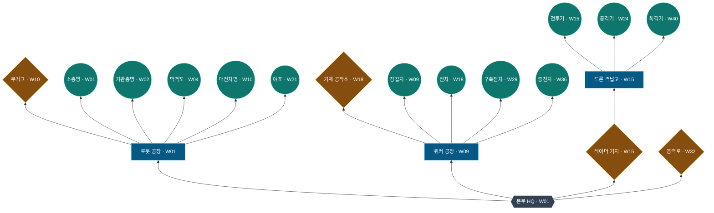

# WW52 통합 기술트리·고유 강화 설계 및 대화 검증 기록

- 기준일: 2026-11-04
- 상태: **사용자 최종 승인 전의 통합 설계 후보**. 기존 게임 코드 미반영, 경제·전투·실제 재미 미검증.
- 작성 위치: `C:\GPT-Workspace\w52\docs`
- 원본 참조: `C:\GPT-Workspace\no.use\defdef`. `w52`는 별도 Godot 프로젝트.
- 이번 변경: **이 신규 Markdown 문서 1개만 작성**. 게임 코드, 기존 UI 문서, `defdef` 원본은 변경하지 않음.

> 설계 핵심: **본부(HQ) 뿌리 → 생산시설/공유 기술 건물 → 12종 유닛(트리 20개 노드)**. 고유 강화 24개는 **트리 밖 유닛 상세 패널에서만 표시**한다. 건설 대기시간 없음. 서로 관련 없는 유닛 연구를 다른 유닛의 선행 조건으로 강제하지 않음. 주차, 가격, 유닛 성능, 업그레이드 해금 정책은 아직 확정하지 않음.

## 1. 대화 요구사항과 합의·미결정 구분

| 쟁점 | 사용자가 요구한 방향 | 처리 상태 |
|---|---|---|
| 장르 | HQ에서 위로 확장하는 **기술트리 중심 빌드 게임** | 핵심 불변 조건 |
| 스타크래프트식 재미 | 다른 분야 건물을 확보해야 고급 유닛을 생산할 수 있는 교차 기술 | 채택한 설계 방향 |
| 논리적 선행 | '전투기를 연구해야 전차 생산' 같은 무관한 병종 간 강제 연구 배제 | 설계 규칙으로 반영 |
| 연구소 역할 | 건물 1개가 유닛 1개만 여는 1:1 해금 구조 배제 | 공유 기술 건물로 해결 |
| 건설 시간 | 워커 1주·드론 2주를 포함해 **전부 제거** | 건물은 구매 즉시 완공 |
| 명칭 | 사람들이 알 수 있는 한국어 및 자연스러운 영문 이름 | 건물 이름 후보 적용 |
| 초반 유닛 | 고급 유닛 이후에도 기본 성능만으로 채용 이유 유지 | 성능 수용 기준 정의 |
| 고유 강화 | 유닛별 **최대 3개 이하** | **2개씩(총 24개)** 추천; **트리에는 미표시**, 유닛 상세 패널에서만 확인/구매 |
| 강화 조건 | '돈만 있으면 구매' vs '특별 해금 필요' **미결정** | 가벼운 혼합형을 **추천만** 함 |
| 노드 모양/크기 | 본부 육각형, 생산시설 모서리 직각 정사각형, 기술시설 마름모, 유닛 원형 | **요청 반영**, 크기는 UI 후보 |
| 트리 공개 규칙 | 한 단계 위 예고 / 선과 시설의 등장 순서 검토 | **기본 추천:** 보유 경로+1단계 예고, 완공 시 선 먼저 강조 후 다음 노드 공개, 전체 보기 별도 |
| 스탯·가격·주차 | 과거 `defdef` 수치도 미확정 | 전부 후보로 명시 |
| 결과 전달 | 대화/자료를 재검토하고 검증 후 `w52/docs`에 기록 | 본 문서로 수행 |

근거 문서: `no.use/defdef/README.md`, `WW52_전멸전_통합게임기획서_52주_교차빌드_시뮬레이션_v1.md`, `WW52_12종_유닛_상성_기본스탯_고유업그레이드_설계안.md`, `WW52_주차별_해금요소_시나리오대화_52주_v1.md`. 스토리의 최신 원고는 `WW52_52주_연결형_스토리_대사_v4.md`이며, **스토리 v4는 전투·기술·경제 규칙을 자동 변경하지 않음**.

## 2. 반복 검증 중 확인된 이전 제안의 오류와 조치

| 이전 답변의 충돌/위험 | 수정·판단 |
|---|---|
| AI 생성 기술트리 그림 일부에서 기관총병이 W09로 보였음 | 기관총병은 **W02 후보**. 과거 이미지는 정본으로 사용하지 않음 |
| 무기고 W13인데 대전차병 W10에 무기고를 요구하는 선후 모순 | 무기고 **W10**, 박격포 W04는 무기고 불필요. 최단 주차 일치 |
| 원래 워커 1주·드론 2주 건설 대기가 일부 설명에 남음 | 최신 요청에 따라 **모든 건물 대기 0주** |
| 원안 W17 전투기·W28 공격기 등을 새 후보 주차와 혼용 | 원본/조정안을 별도 표로 구분 |
| 건물 하나가 유닛 하나만 해금하면 의미 부족 | **Armory, Radar Station, Machine Shop, Reactor**를 여러 병종이 공유 |
| 폭격기에 격납고·레이더(격납고 선행)·무기고·동력로가 중첩됨 | **격납고+동력로**로 1차 단순화. 무기고는 공격기에 사용 |
| 초기 `defdef`의 12개 병종별 필수 연구와 건물 테크를 이중 결제할 위험 | 이 후보는 **별도 1:1 필수 병종 연구를 제거**, 고유 강화만 구매 연구로 제안 |
| 업그레이드 구매법·게임성이 확정된 것처럼 표현 | **추천/미승인/미검증**으로 정리 |
| `no.use/ww`와 `w52` 프로젝트가 혼동될 위험 | `w52`는 현행 Godot UI 시연판이라는 점을 명시 |
| 44개 트리 노드로 강화 24개를 그린 과거 그림/설계 | 최신 사용자 요구에 따라 **강화는 트리·연결선·강화 슬롯 배지에 표시하지 않음**. 트리는 **8건물+12유닛=20개 노드** |

위 조정은 **문서 내부의 모순을 해소하기 위한 설계 제안**이며, 사용자가 모든 세부 규칙을 승인했다는 뜻은 아니다.

## 3. 통합 기술트리 규칙

1. **본부(HQ)** 1개를 트리 뿌리로 두고, 모든 건물은 하나의 화면상 부모 노드가 있다.
2. **생산시설 3개**: Robot Factory(로봇), Walker Factory(워커), Drone Hangar(드론).
3. **전문 건물 4개**: Armory(무장·로켓), Radar Station(관제·정밀 조준), Machine Shop(고급 차체), Reactor(고출력 동력).
4. 건물은 **구매 시 즉시 완공**. 선행 건물 및 주차와 자원 조건은 남는다.
5. 유닛 해금은 `현재 주차 ≥ 최소 주차` AND `필수 생산시설 보유` AND `추가 전문 건물 전부 보유`. **다른 유닛의 연구 완료**는 요구하지 않는다.
6. 유닛 노드가 노출·해금되는 것과 해당 유닛을 **실제로 생산할 재화**가 있는 것은 별개다.
7. 각 전문 건물은 2종 이상의 병종에 **직접 또는 간접적으로 기여**한다.
8. 트리의 **기본 실선은 화면 부모 관계**만 표현. 다른 가지에 있는 추가 건물 조건은 각 유닛 카드의 요건/배지와 선택 시 경로 강조로 표현한다.
9. **강화는 기술트리 노드가 아니다.** 강화 이름/아이콘/슬롯/연결선을 트리 안에 그리지 않는다. 24개 강화의 효과와 구매 UI는 해당 유닛을 클릭하여 열린 **별도 상세 정보 패널**에서만 보여 준다. 강화 구매·보유 상태가 트리의 노드 수·경로·표시 깊이에 영향을 주지 않는다.
10. 다른 건물·유닛 투자 때문에 다음 캠페인 주차에 **진입할 수 없는 구조**는 금지한다. 승리 가능한지는 별도 검증.

### 3.1 건물 8개

| ID | 표시 이름 / 영어 | 부모 | 최소 건설 가능 주차 후보 | 완공 | 기능 |
|---|---|---|---:|---|---|
| `hq` | 본부 / HQ | 없음 | W01 | 기본 지급 | 단일 뿌리 |
| `robot_factory` | 로봇 공장 / Robot Factory | HQ | W01 | 기본 지급 | 5종 로봇 생산 |
| `walker_factory` | 워커 공장 / Walker Factory | HQ | W09 | 즉시 | 4종 워커 생산 |
| `armory` | 무기고 / Armory | Robot Factory | W10 | 즉시 | 로켓·포격·공격기 무장 기술 |
| `radar` | 레이더 기지 / Radar Station | HQ | W15 | 즉시 | 드론 관제·장거리 정밀 조준 |
| `drone_hangar` | 드론 격납고 / Drone Hangar | Radar Station | W15 | 즉시 | 3종 드론 생산 |
| `machine_shop` | 기계 공작소 / Machine Shop | Walker Factory | W18 | 즉시 | 전차 차체·고급 워커 플랫폼 |
| `reactor` | 동력로 / Reactor | HQ | W32 | 즉시 | 중전차·폭격기 고출력 동력 |

영문 건물명은 범용적인 SF/RTS 어휘를 우선했다. `장갑차`는 원안 이름을 우선 보존했으나 워커 계열의 외형·명칭을 `경량 워커(Light Walker)`로 바꿀지는 별도 결정 대상이다.

### 3.2 전체 트리 — 건물 8개 + 유닛 12종 = 20개 노드

`w52`의 기술트리는 **본부에서 위로 자라는 상향식(`flowchart BT`)** 배치다. **강화 24개는 이 트리에 포함하지 않는다**. 마름모는 기술시설, 직각 정사각형은 생산시설, 육각형은 본부, 원은 유닛을 의미한다. 다른 가지에 있는 **교차 선행 건물**은 아래 표와 선택한 유닛의 상세 요건에서 표시한다. 이 관계는 기본 도표에 항상 보이는 별도 실선으로 그리지 않는다.

**도표 해석:** 기본 트리의 19개 부모선은 `treeParentId`이고, 생산·해금에 필요한 **필수 건물 목록**은 별도 필드로 관리한다. 기술시설과 생산시설은 여러 유닛에 공유될 수 있다. 개념도는 전체 보기이며, 실제 게임에서는 3.4절의 깊이별 공개 규칙을 사용한다.

**해금 선행 관계(교차 기술 포함):**

| 계열 | 유닛 | 최초 가능 주차 후보 | 생산시설 | 추가 필수 건물 | 타 유닛 연구 선행 |
|---|---|---:|---|---|---|
| 로봇 | 소총병 | W01 | Robot Factory | 없음 | 없음 |
| 로봇 | 기관총병 | W02 | Robot Factory | 없음 | 없음 |
| 로봇 | 박격포 | W04 | Robot Factory | 없음 | 없음 |
| 로봇 | 대전차병 | W10 | Robot Factory | Armory | 없음 |
| 로봇 | 야포 | W21 | Robot Factory | Armory + Radar Station | 없음 |
| 워커 | 장갑차 | W09 | Walker Factory | 없음 | 없음 |
| 워커 | 전차 | W18 | Walker Factory | Machine Shop | 없음 |
| 워커 | 구축전차 | W29 | Walker Factory | Machine Shop + Radar Station | 없음 |
| 워커 | 중전차 | W36 | Walker Factory | Machine Shop + Reactor | 없음 |
| 드론 | 전투기 | W15 | Drone Hangar | 없음: 격납고 자체가 Radar Station 필요 | 없음 |
| 드론 | 공격기 | W24 | Drone Hangar | Armory | 없음 |
| 드론 | 폭격기 | W40 | Drone Hangar | Reactor | 없음 |

**논리적 근거:** 야포=포격 기술+장거리 관제, 구축전차=기갑 차체+정밀 표적, 중전차=대형 차체+고출력 동력, 공격기=드론+고급 무장, 폭격기=드론+대형 추진 동력. 서로 무관한 *유닛 연구*를 교차 관문으로 강제하지 않는다.

### 3.3 노드 도형·크기·시각적 위계(신규 UI 설계 후보)

사용자가 **도형 유형을 지정**했고, 수치는 실제 1920×1080 논리 해상도에서 시각 검토할 **초기 추천값**이다. 노드 크기는 **역할의 종류**를 나타내며, 병종의 강함이나 주차가 올라가도 도형 크기를 키우지 않는다.

| 노드 유형 | 개수 | 모양(형태 확정) | 논리 크기 후보 | 라벨 기본 |
|---|---:|---|---|---|
| 본부(HQ) | 1 | **육각형** | **104×104px** 외접 영역 | 도형 아래 항상 표시 |
| 생산시설 | 3 | **각진 정사각형** (모서리 반경 **0px**) | **88×88px** | 항상 표시 |
| 기술시설 | 4 | **마름모** | **80×80px** 외접 영역 | 항상 표시 |
| 유닛 | 12 | **원형** | **지름 72px** | 항상 표시 |
| 강화 | 0 (트리 밖) | **트리 전용 도형 없음** | 트리 크기 정의 없음 | 유닛 정보창에서만 표시 |

- **기본 크기 100%**, 기존 UI 계약의 호버·선택 **112%**를 후보로 유지한다(동시에 2중 확대하지 않음). 명도·테두리·상태 아이콘으로 보유/잠금/구매 가능을 구분하며, **모양만으로 상태를 인코딩하지 않는다**.
- **선택 시 카메라 포커스**, 빈 배경/노드 드래그 이동, 좌측 `TreeClip` 안에서의 전체 아이콘+이름 1개 이상 가시성 등 `docs/UI_LAYOUT_DESIGN.md`의 현행 상호작용 원칙을 존중한다.
- **클릭 판정**은 도형 종류별 실제 경계 또는 충분히 넓은 터치 영역을 사용할 수 있다. 마름모의 뾰족한 꼭짓점과 원형 경계에서 오작동하지 않도록, 적어도 **각 노드 기본 바운딩 영역 이상의 클릭 영역**을 확보하는 것을 권장한다.
- 라벨과 노드 사이·인접 가지 사이의 여백은 **112% 확대 상태에서 충돌하지 않도록** 결정한다. 노드 개수가 20개라도 일부 가지에 병종이 집중되어 자동 줄바꿈/스크롤/카메라 포커스에 대한 UI 검수 필요.
- 색상은 종류를 보조하는 수단일 뿐이다. **본부 육각 / 생산 직각 사각 / 기술 마름모 / 유닛 원**으로 색각 조건에서도 구분되어야 한다.

### 3.4 단계별 노드 공개와 연결선 성장 연출(신규 UI 권장안)

**한 번에 전체 20개를 모두 노출하는 대신 기본 모드는 '보유 경로 + 다음 1단계 예고'를 권장**한다. 단, 장기 빌드 계획의 불이익을 막기 위해 **전체 기술도 모드**는 따로 제공한다(공개 범위는 스토리 스포일러 정책과 별도 확인).

| 가시/구매 상태 | 노드 표시 | 연결선 표시 | 의미 |
|---|---|---|---|
| 미발견 | 숨김 | 숨김 | 기본 트리의 보유 경로+1단계 바깥; 전체 보기에서는 확인 가능 후보 |
| 다음 단계 **예고** | 흐린 도형+이름+잠금 조건 | **희미한 연결선이 노드와 함께 표시** | 아직 최소 주차나 필수 건물이 부족해도 계획할 수 있음 |
| 해금됨·자원 부족 | 선명한 형태, 구매 버튼은 부족 물자 안내 | 기본 경로 선명 | 조건 충족, 돈만 부족. 잠금과 구별 |
| 해금됨·구매 가능 | 선명한 테두리/구매 가능 표시 | 기본 경로 선명 | 주차·필수 건물·물자 모두 충족 |
| **건물 보유** | 보유 체크, 선명한 형태 | **기존 희미한 부모선이 선명** | 보유 건물의 다음 1단계 예고 확장 |
| **유닛 생산 가능** | 유닛 원형에 생산 가능 상태 | 생산시설과 연결 유지 | **유닛 구매는 매주 반복**될 수 있음. '영구 보유' 체크와 혼동 금지 |

**단계 깊이의 기준:** 건물의 영구 **소유(완공)**를 기준으로 다음 자식 건물/유닛 **1단계**가 예고된다. 유닛을 한 번 배치한 사실이나 A/B 업그레이드 보유가 새로운 트리 가지를 열지 않는다. 최소 주차가 아직 오지 않은 노드는 자식 깊이에 들어왔으면 예고할 수 있으며, 선택 시 주차를 보여 준다.

**등장 순서:** 새 건물을 구매하면 (1) 기존 예고 부모선 강조 → (2) 다음 자식으로 **선이 짧게 뻗는 애니메이션** → (3) 새 예고 노드 등장. **연결되지 않은 시설을 먼저 띄우고 뒤늦게 선을 붙이는 방식은 기본안에서 제외**한다. 애니메이션 길이 **0.2~0.4초**는 테스트할 후보이며, 사용자의 동작을 지연시키거나 필수 입력을 막지 않는다. '움직임 감소' 설정에서는 즉시 표시한다.

**교차 선행 조건:** 야포처럼 화면상의 생산 가지 밖에 `Armory + Radar Station`이 요구되는 경우, 평소에는 복수 교차 연결선을 그리지 않는다. 유닛 노드 선택 시 정보창의 **요구 건물 체크리스트**를 보이고, 현재 숨겨진 필수 건물 위치는 해당 경로를 **일시적으로 노출/포커스**해 찾을 수 있게 한다. 기본 모드에 없다는 이유로 요건을 확인할 수 없으면 안 된다.

**전체 기술도 보기:** 언제든 전체 **20노드**와 부모선·최소 주차·추가 건물 조건을 조회하는 탐색 모드(추천). 미래의 **스토리 대사·적 편성은 공개하지 않는다**. 전체 기술도는 노드 확인용이며 건물·유닛 구매는 기존 주차/조건에 의해서만 가능하다.

**강화 표시 금지:** 기본/전체 기술도 어디에서도 A/B 아이콘·캡슐·슬롯 배지·노드·연결선을 그리지 않는다. **유닛 선택 → 별도 정보창의 강화 항목**에서 효과·가격·구매/보유 상태를 확인한다. 따라서 강화의 구매/환불은 **트리 연결선·가시 깊이에 영향을 주지 않는다**.

**이 규칙은 아직 게임에 구현되지 않았다.** 현행 `scripts/game.gd`의 8개 시연 노드는 단순 주차 기반 노출/구매 UI이며, '보유 경로 + 1뎁스' 및 교차 선행 체크리스트는 새로운 설계 후보로 기록한다.

## 4. 고유 강화: 병종당 2개(총 24개), 최대 3개 제한

**강화는 기술트리에 표시하지 않는다(사용자 지정).** 유닛 선택 시 별도 상세 정보 패널에 목록·효과·비용·구매/보유 상태를 표시한다. **추천 구매 방식(미확정):** 필수 건물·주차 조건으로 **병종이 먼저 해금**되면 A/B 강화를 준비 단계에서 각각 군수물자로 **영구 구매**한다. 두 강화는 독립적으로 1회씩 구매 가능하며 서로 배타적이지 않다. **추가 건물/주차 해금 조건은 붙이지 않는 것을 기본 권장**한다. '돈만 있으면 바로'와 '강화별 해금' 중 사용자 최종 선택은 남아 있다.

| 유닛 | 강화 A 제안 | 강화 B 제안 | 강화 없이 보존할 기본 역할 |
|---|---|---|---|
| 소총병 | 고속 장전(연사) | 대공 추적(공중 대응 개선) | 저비용 범용 + 기본 대공 보조 |
| 기관총병 | 연사 강화(지속 화력) | 표적 전환(경량 다수) | 빠른 연사 |
| 박격포 | 확산 포탄(광역) | 자동 장전(속도) | 소형 저비용 간접포격 |
| 대전차병 | 관통탄(장갑 피해) | 유도 조준(표적 추적) | 기본 대장갑 특화 |
| 야포 | 장포신(사거리) | 고폭 포탄(포격 범위) | 강한 장거리 후열 화력 |
| 장갑차 | 추가 장갑(생존) | 속사 포탑(경량 표적) | 저비용 기동·장갑 전열 |
| 전차 | 복합 장갑(생존) | 고폭탄(소형 광역) | 범용 공방 균형 |
| 구축전차 | 관통 포탄(대장갑 화력) | 정밀 조준(표적 추적) | 강한 단일 대전차 |
| 중전차 | 강화 장갑(생존) | 중포탄(일격) | 고내구 전열 |
| 전투기 | 요격 레이더(공중 탐지) | 속사 기관포(연사) | 빠른 공중 요격 |
| 공격기 | 확산 로켓(광역) | 정밀 유도탄(장갑 대응) | 지상 지원·범위 공격 |
| 폭격기 | 확산 폭탄(범위) | 중량 폭탄(일격) | 대규모 폭격 |

- 각 강화의 수치·가격·실제 AI 적용 방식은 **추후 실험 후 확정**. 원안의 HP/DPS/상성/가격을 확정 규칙처럼 사용하지 않는다.
- 기본 유닛의 역할을 A/B 강화를 사야 얻도록 만들지 않는다. A/B는 기본 장점을 증폭하거나 보조적인 선택을 제공해야 한다.
- 표적 추적·전환·대공 우선은 단순 스탯 증가로 구현할 수 없을 수 있다. 실제 전투 AI와 연동 여부가 필요하다.
- 세 번째 강화는 사용자가 허용한 **상한**이지 기본 포함 의무가 아니다.

## 5. 주차별 개방과 중반 다양성 검증

### 5.1 후보 전체 해금표

| 주차 | 새 유닛 | 누적 유닛 종수 |
|---:|---|---:|
| W01 | 소총병 | 1 |
| W02 | 기관총병 | 2 |
| W04 | 박격포 | 3 |
| W09 | 장갑차 | 4 |
| W10 | 대전차병 | 5 |
| W15 | 전투기 | 6 |
| W18 | 전차 | 7 |
| W21 | 야포 | 8 |
| W24 | 공격기 | 9 |
| W29 | 구축전차 | 10 |
| W36 | 중전차 | 11 |
| W40 | 폭격기 | 12 |

### 5.2 `defdef` 원안과 조정 후보 비교

| 병종 | 초기 `defdef` 해금 주차 | 현재 후보 | 변화 |
|---|---:|---:|---|
| 소총병 / 기관총병 / 박격포 | W01 / W02 / W04 | 동일 | 초반 기본 전력 유지 |
| 장갑차 / 대전차병 | W09 / W10 | 동일 | 중반 진입 준비 |
| 전투기 | W17 | **W15** | 항공 분기 조기 확보 |
| 전차 | W18 | W18 | 장갑차 연구 강제는 제거 |
| 야포 | W21 | W21 | 무기고+레이더로 해금 |
| 공격기 | W28 | **W24** | 중반 드론 선택 확대 |
| 구축전차 | W33 | **W29** | 중반 대전차 선택 확대 |
| 중전차 | W36 | W36 | 고급 기갑 유지 |
| 폭격기 | W41 | **W40** | 후반 항공 완성 |

- **중복 해금 주차 자체는 문제가 아니다.** 한 주차에서 여러 건물을 구매할 수 있어도 돈과 배치 칸이 제한되어 선택의 기회비용이 있어야 한다.
- W15 전투기는 Radar Station + Drone Hangar를 그 주에 구매해야 하므로 **이론적으로 도달**할 뿐, 실제 금전적으로 가능한지는 아직 모른다.
- W15~23은 로봇·경량/중형 워커·전투기·야포 선택, W24~35는 공격기·구축전차로 전문화가 늘어나는 후보.
- 총 유닛 수가 많다는 사실은 유효한 빌드 수를 증명하지 않는다. 예산, 보상, 출전 상한, 적 편성, 지형을 포함한 실제 시뮬레이션이 필요하다.

## 6. 초반 유닛의 후반 가치 — 고급 병력 이후에도 채용할 근거

| 초반·기본 병종 | 업그레이드 **없이도** 남길 전문성 | 고급 유닛과의 구분 |
|---|---|---|
| 소총병 | 저렴한 범용 사격, 공중 소형 적 대응, 빈틈 메움 | 비싼 대형 병종과 다른 비용 효율 |
| 기관총병 | 연속 사격과 빠른 경량 적 제거 | 큰 일격의 과잉 피해를 줄임 |
| 박격포 | 저비용 밀집·간접 화력 | 야포보다 저렴한 광역 지원 |
| 대전차병 | 보병형 저비용 대장갑 | 구축전차와 가격·이동·전열 차이 |
| 장갑차 | 경량 워커 전열, 빠른 연사 | 전차보다 저렴한 기동·보조 |
| 전투기 | 빠른 공중 요격·분산 적 추적 | 공격기·폭격기와 다른 임무 |

**설계 원칙:** 중전차는 전차·장갑차의 절대적인 상위 대체제가 아니고, 구축전차는 중전차보다 '무조건 강한 전차'가 아니라 전문 대장갑 플랫폼이다. 전투기/공격기/폭격기도 직렬 업그레이드 관계가 아니라 요격/지상 지원/광역 폭격이라는 병렬 전문화다.

검증해야 할 실패 유형: 저가 유닛의 고급 유닛 대체 불가 이유가 '돈이 부족해서'뿐임; 마린처럼 원래 유용한 역할이 업그레이드 후에야 생김; 계열 상성으로 대전차병의 대장갑 특화가 무력화됨; 작은 광역 반경이 실제 유닛 이격거리 탓에 다중 명중하지 못함.

### 후반 밸런스 수용 기준(확정 수치 아님)

1. W36~52에 초급 6종이 각각 적어도 일부 상황에서 **업그레이드 0단계**로도 채용 가치가 있어야 한다.
2. 동일 **군수물자** 비교와 동일 **배치 칸 수** 비교를 구분해 평가한다.
3. W24/W36/W48/W52에서 로봇 물량·워커 전열·항공 지원·혼합을 각각 테스트한다.
4. 혼합 빌드가 항상 최강이어도 안 되고, 최고 등급 유닛만 반복 구매하는 것이 항상 정답이어도 안 된다.
5. 건물 환불 시 교차 의존을 망가뜨리는 환불을 막고, 다음 주차로 넘어가기 위해 특정 선택 연구를 강제하지 않는다.

## 7. 최초 설계와 현재 후보의 비교 및 리스크

| 항목 | 최초 `defdef` 기획 | 현재 통합안 | 일반적 판단 |
|---|---|---|---|
| 건물 | HQ·로봇·워커·드론, 4개 | HQ + 생산 3 + 기술 4, **8개** | 건물 투자의 선택·재사용 증가 |
| 기술 선행 | 서로 다른 유닛 연구를 교차 요구 | 공유 전문 건물 요구 | 설명 가능한 선행으로 개선 |
| 건설 시간 | 워커 1주 / 드론 2주 | **0주** | 흐름 간결, 선투자 위험 감소 |
| 연구 | 병종별 1:1 연구 12개 | 병종 잠금은 건물/주차, 선택 강화 24개 | 중복 선행 구매 완화 |
| 기술트리 UI | 본부에서 가지로 확장 | HQ 뿌리, **20개 노드** 상향 확장 + 강화는 별도 패널 | 44노드 전부 표시하는 이전안보다 트리 가독성 개선 기대 |
| 중반 선택 | W17~28 드론 병종 폭 제한 | W15 전투기·W24 공격기 | 구조적 다양성 개선 가능 |
| 초기 유닛의 후반 가치 | 목표로만 제시 | 기본 역할·테스트 조건 명시 | **실제 전투 근거는 없음** |

**특히 주의할 점:**

- **경제:** 공장과 연구소가 즉시 완공되므로 가격·보상에 선택의 기회비용을 부여해야 한다. 전부 사는 것이 최선이면 트리 재미가 약해진다.
- **교차 의존:** 생산시설 외에 추가 전문 건물 **최대 2개**를 한 병종의 필수 해금 조건으로 권장한다. 더 많은 관문은 정보량과 투자 부담을 키운다.
- **레이더·격납고:** 모든 드론이 레이더를 간접 선행으로 요구하지만 *다른 유닛 연구*는 요구하지 않는다. 워커 공장을 거치지 않는 드론 전환이 가능하다.
- **환불:** `defdef`의 W19 공통 환불 사건은 참고 정책. 새 건물 간 의존과 업그레이드 소유권·배치된 유닛에 대한 환불 차단 검증 필요.
- **서사:** 최신 스토리 v4는 공장 보유를 강제하지 않는다. 새로운 조기 해금 때문에 특정 시설을 구매했다고 대사에서 단정하지 않는다.
- **게임성:** 구조가 이전보다 적절할 *가능성*은 크지만 **실제 재미·승률·경제가 더 낫다는 검증 결과는 아니다**.

## 8. `w52` 저장소 현재 구현과 분리해서 볼 것

`w52/README.md`, `w52/docs/UI_LAYOUT_DESIGN.md`, `w52/docs/game-flow-design.md`, `w52/scripts/game.gd` 확인 결과:

- 현재 `w52`는 **Godot 4.7.2/GDScript 기반 PC·웹 UI 시연판**이다. `scripts/game.gd`에 있는 트리 시연 노드는 `root, command, guard, scout, mobility, supply, drone, elite` 총 8개다.
- 이 문서의 **기술트리 8건물+12유닛=20노드**는 **아직 실제 `w52` 게임의 데이터나 UI에 적용되지 않았다**. 유닛 고유 강화 24개는 트리 외부의 개별 상세 패널 기능 후보이며 트리 노드가 아니다.
- 기존 UI는 왼쪽 스킬트리에서 **뿌리에서 위로 성장**, 드래그·선택 중앙 포커스·트리 클리핑/최소 노드 가시성을 계약으로 가진다. **20노드** 이식 시 모양별 경계/클릭/레이아웃, 1뎁스 공개, 교차 조건 요건 표시, 강화 상세 패널을 검증해야 한다.
- 현 `w52`의 시작 160G / 시연 전투 비용 40G / 승리 보상 70G / 52주 시연 진행은 **정식 전투·경제 수치가 아니다**.
- 기존 저장 버전 2는 건물 구매, 영구 업그레이드, 환불·투자 로그를 기록하지 않는다. 실이식 시 저장 포맷·재개 및 호환성 정책 검토가 필요하다.
- `no.use/ww`는 별도의 JavaScript 구현이고 `no.use/defdef`는 독립 기획 폴더다. 기술트리를 같은 코드로 실행 중이라고 간주하지 않는다.
- 본 작업은 **문서 추가만** 수행하고 Godot 실행/웹 배포/밸런스 시뮬레이션은 수행하지 않는다.

### 추후 구현 시 예상 영향

`scripts/game.gd` 트리 노드·잠금/구매 상태, 팝업·클리핑·스킬트리 드래그, 경제 G 및 투자·환불, 전투 AI(표적 추적·대공·광역), 52주 보상·전장·적 편성, 스토리 트리거, 저장 버전·PC/Web 공통 검증. **이번에 변경하지 않는다.**

## 9. 검증 루프 및 남은 경계

### 루프 1 — 대화/원안/현재 구현의 대조

- **발견:** 그림 주차 오기, 무기고 해금 역전, 건설 대기 혼합, 이전 AI 추천을 확정 요구로 표현, 서로 다른 저장소 혼용.
- **교정:** 이 문서에서 주차·정책·소스 상태를 분리하고, 그래프 요건을 하나의 통합 후보로 정리.
- **아직 확정하지 않은 사항:** 건물/병종/강화 비용, 최종 주차, 추가 연구 체계, 새로운 전투 AI 동작.

### 루프 2 — 선행 그래프 구조 검사

- 검사 대상: **트리 8개 건물 + 12개 유닛 = 20노드, 연결선 19개**. 별도 유닛 상세 패널 목록의 24개 강화는 트리에서 제외.
- 확인 결과: **미존재 선행 노드 0**, **순환 참조 0**, **HQ에서 모든 건물 도달**, **12종 모두 자신의 최소 주차에 이론적으로 도달 가능**.
- **관련 없는 유닛 연구를 필수로 요구하는 관계 0**. 강화는 **각 유닛 상세 정보의 A/B 2개**이며, 트리 노드/연결선이 아니고 최대 3개 제한을 준수.
- 이는 **그래프·시점의 정적 검증**이지, 자원으로 실제 구매 가능한지/전투에서 이길 수 있는지에 대한 검증이 아님.

### 루프 3 — 설계와 Godot 현행의 구분

| 검사 항목 | 판정 | 경계 |
|---|---|---|
| 건물 트리 1뿌리·다중 공유 | 설계 일관성 확인 | 런타임 미적용 |
| 공장·연구소 건설 0주 | 설계 일관성 확인 | 구현 미적용 |
| 다른 유닛 연구 강제 없음 | 그래프 검사 통과 | 구현 미적용 |
| 병종당 2개 고유 강화 | 개수 검사 통과, **트리 비표시** | 업그레이드 구매 규칙 미승인 |
| W15~W32 빌드 다양성 | **부분 검증** | 자원·상성·전투 미검증 |
| 초반 유닛의 후반 효율 | **검증 불가** | 역할과 테스트 기준만 정의 |
| 52주 전투 승률·Godot 실행/배포 | **미실시** | 문서 작업만 수행 |

**정확한 종료 판단:** 현 후보의 **명백한 기술트리 구조·주차 모순을 제거**했지만, 경제/전투 재미/실제 `w52` 플레이 정상 여부를 검증 완료했다고 주장하지 않는다.

## 10. 향후 결정할 사항(미승인 목록)

1. **업그레이드 해금:** (추천) 유닛 해금 후 돈으로 A/B 독립 구매 vs 업그레이드별 추가 주차·기술 조건. 지금은 확정하지 않음.
2. **주차:** 워커 W09·무기고 W10·레이더/드론 W15·기계 W18·동력로 W32, 공격기 W24·구축 W29·폭격 W40의 후보 승인 여부.
3. **경제:** 즉시 완공 건물 4개 추가를 반영한 가격/승리 보상/전투 배치비/환불 비용.
4. **공통 연구:** 현재는 공유 전문 *건물*이 여러 병종을 해금한다. 탄도학·장갑학 등 병종 여러 개에 적용되는 **별도 공통 강화 연구 노드**를 넣을지는 선택 사항이며 지금 추가하지 않음.
5. **유닛 외형과 명칭:** 소총(이족), 기관총(안정형 다족), 박격포(간접포격 플랫폼), 대전차(로켓 탑재), 야포(장거리 다족) 등 로봇 형태 변경 가능. 워커 계열 '장갑차'의 최종 이름 미확정.
6. **전투 AI:** 표적 우선/추적/대공 및 광역 타격 판정, 계열 상성과 특화 공격의 상호작용.
7. **코드 적용:** `w52` Godot 시연판에 이 **20노드 트리 + 별도 강화 상세 정보 패널**을 언제 어떤 저장 규격으로 이식할지.

---

**최종 상태:** 기술트리는 **8건물+12유닛=20노드**, 강화는 **12종×2=24개(트리 미표시)**이다. 문서의 기술트리 구조는 정적 검증상 모순 0건인 **비승인 설계 후보**다. 초반 병종의 후반 가치 및 중후반 빌드의 실제 유효성, 강화 정책, 경제/전투 결과는 후속 검증 범위다.
